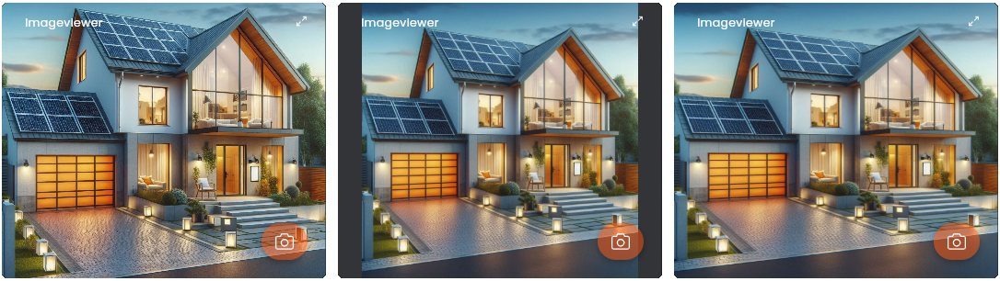

# 📸 Bildbetrachter (Image Viewer)

[](https://wilkware.de/module/bildbetrachter/)
[](https://www.symcon.de/service/dokumentation/entwicklerbereich/sdk-tools/sdk-php/)
[](https://www.symcon.de/produkt/)
[](https://github.com/Wilkware/ImageViewer)
[](https://creativecommons.org/licenses/by-nc-sa/4.0/)
[](https://github.com/Wilkware/ImageViewer/actions)

Mit diesem Modul können Sie Einzelbilder und Motion-JPEG-Streams direkt in einer vollflächigen Kachel anzeigen. Die Darstellung wird entsprechend der eingestellten Bildanpassung skaliert.



## Inhaltverzeichnis

1. [Funktionsumfang](#user-content-1-funktionsumfang)
2. [Voraussetzungen](#user-content-2-voraussetzungen)
3. [Installation](#user-content-3-installation)
4. [Einrichtung](#user-content-4-einrichtung)
5. [Statusvariablen](#user-content-5-statusvariablen)
6. [Darstellungen](#user-content-6-darstellungen)
7. [Visualisierung](#user-content-7-visualisierung)
8. [Befehlsreferenz](#user-content-8-befehlsreferenz)
9. [Versionshistorie](#user-content-9-versionshistorie)

### 1. Funktionsumfang

Durch Nutzung des HTML-SDKs kann dieser Bildbetrachter Inhalte nun kachelfüllend darstellen – was mit der klassischen HTMLBox bisher nicht möglich war. Unterstützt werden sowohl MJPEG-Streams (z. B. von IP-Kameras) als auch statische Bildquellen.  
Darüber hinaus kann festgelegt werden, wie der Bildinhalt relativ zur Kachelgröße skaliert und angepasst werden soll.

### 2. Voraussetzungen

* Symcon ab Version 8.1

### 3. Installation

* Über den Modul Store das Modul _Bildbetrachter_ installieren.
* Alternativ über das Modul Control folgende URL hinzufügen.  
`https://github.com/Wilkware/ImageViewer` oder `git://github.com/Wilkware/ImageViewer.git`

### 4. Einrichtung

* Unter 'Instanz hinzufügen' ist das _Bildbetrachter_-Modul unter dem Hersteller '(Geräte)' aufgeführt.
Weitere Informationen zum Hinzufügen von Instanzen in der [Dokumentation der Instanzen](https://www.symcon.de/service/dokumentation/konzepte/instanzen/#Instanz_hinzufügen)

__Konfigurationsseite__:

_Einstellungsbereich:_

> 📸 Bild ...

Name                              | Beschreibung
--------------------------------- | -------------------------------------------
URL der Bild-Ressource            | Quell-URL des darzustellenden Bildes/MJPG

> ✨ Visualisierung ...

Name                              | Beschreibung
--------------------------------- | -------------------------------------------
Hintergrundfarbe                  | Hintergrundfarbe der Kachel
Bildanpassung                     | Ausfüllen (cover), Einpassen (contain) oder Strecken (fill)

> ⚙️ Erweiterte Einstellungen ...

Name                              | Beschreibung
--------------------------------- | -------------------------------------------
Dynamische Änderung der Bild-URL zulassen! | Erlaubt das dynamiche Austauschen der URL-Konfiguration (IPS_SetProperty/IPS_ApplyChanges).
Anzeigen eines Buttons zum Erstellen eines neuen Snapshots! | Rechts unten wird ein Button (overlay) auf dem Bild angezeigt zum Erstellen eines neuen Bildes (Skript oder Variablenaktion).
Skript                            | Script, welches den Snapshot erzeugt
Variable                          | Variable, dessen Action den Snapshot auslöst

### 5. Statusvariablen

Es werden keine Statusvariablen angelegt.

### 6. Darstellungen

Es werden keine Darstellungen oder Profile benötigt.

### 7. Visualisierung

Das Modul kann direkt als Link in die TileVisu eingehangen werden.  
Als Kachel wird ein vollflächiges Bild bzw. Motion-Stream dargestellt.

### 8. Befehlsreferenz

```php
WWXIV_SetImageUrl(int $InstanzID, string $source);
```

Wenn die dynamische Änderung der Image-Url aktiviert wurde, dann kann über 
diese Funktion eine neue Url für das anzuzeigende Bild hinterlegt wedern.
Im Erfolgsfall wird die Url der bis dahin angezeigten Bildes zurückggeben.

__Beispiel__:
```php
WWXIV_SetImageUrl(12345, 'https://wilkware.de/images/sommer-smart-home.jpeg');
```

### 9. Versionshistorie

v2.0.20260713

* _NEU_: Bildanpassung (cover, contain und fill) eingeführt
* _NEU_: Umstellung auf öffentlichen Befehl für das Setzen einer Bild-Url
* _FIX_: Modulpräfix vereinheitlicht auf WWXIV_
* _FIX_: Interne Bibliotheken und Konfiguration überarbeitet und vereinheitlicht
* _FIX_: Fehlende Übersetzungen nachgezogen

v1.2.20260105

* _NEU_: Schalter(Overlay) für Auslöser/Snapshot hinzugefügt
* _NEU_: Umstellung auf IPSModuleStrict

v1.1.20250915

* _NEU_: Projektumstrukturierung hin zu einer globalen CI/CD-Pipeline
* _NEU_: Kompatibilität auf IPS 8.1 hoch gesetzt

v1.0.20250729

* _NEU_: Initialversion

## Entwickler

Seit nunmehr über 10 Jahren fasziniert mich das Thema Haussteuerung. In den letzten Jahren betätige ich mich auch intensiv in der Symcon Community und steuere dort verschiedenste Skript und Module bei. Ihr findet mich dort unter dem Namen @pitti ;-)

[](https://wilkware.github.io/)

## Spenden

Die Software ist für die nicht kommerzielle Nutzung kostenlos, über eine Spende bei Gefallen des Moduls würde ich mich freuen.

[](https://www.paypal.com/cgi-bin/webscr?cmd=_s-xclick&hosted_button_id=8816166)

## Lizenz

Namensnennung - Nicht-kommerziell - Weitergabe unter gleichen Bedingungen 4.0 International

[](https://creativecommons.org/licenses/by-nc-sa/4.0/)
